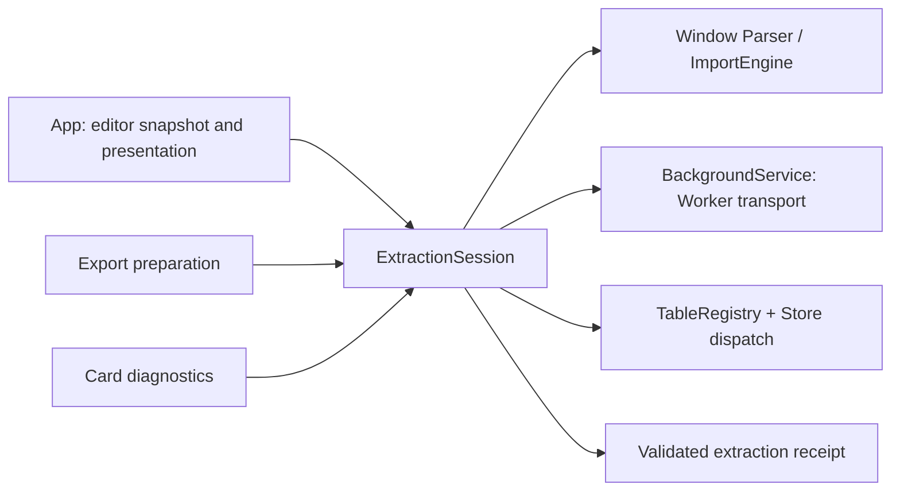

# Architecture

## 1. Delivery architecture

The release application is `index.html`, generated from `src/templates/index.html`, `src/styles/styles.css`, and the ordered source modules under `src/` by `tools/build-release.cjs`. Modules are organized by layer into subdirectories (`core/`, `state/`, `parsing/`, `export/`, `transform/`, `ui/`), with dependency order declared in the build manifest. CSS, markup, parser adapters, state management, transformations, clipboard serialization, XLSX generation, and UI behavior remain self-contained in the generated file. Runtime dependencies and network resources are intentionally absent.

The generated file is intentionally kept as the only end-user artifact, while source modules are the only hand-edited application source. Node scripts under `tools/` build and validate the artifact and are development-only.

## 2. Logical modules

### Core (`src/core/`)

| Module | Responsibility |
| --- | --- |
| `OTA` (module-loader) | Local module registry: `define`, `require`, `start` (`src/core/module-loader.js`) |
| `runtime` | DOM query helpers (`$`, `createEl`), `Tooltip`, `Toast` |
| `TableUtils` | Text/cell normalization, row width handling, unique names and headers, shared export column projection |
| `SourceSnapshot` | Ephemeral clipboard/file source metadata, bounded diagnostic previews, and tab/text matching |
| `FilterEngine` | Pure filtering, highlighting, and column-projection logic (token parsing, regex matching, operator rules). Zero DOM/storage dependencies. |
| `BackgroundService` | Sole owner of local Blob Worker lifecycle, version handshake, cancellation and acknowledged transport |
| `WorkerRuntime` | Background normalized dataset session, query/JOIN/statistics/XLSX and storage jobs |
| `ExtractionSession` | Current-source extraction snapshot, Window/Worker routing, shared pending/completed work, result publication, cancellation and receipt validation; browser presentation is supplied by App. |
| `QueryService` | Pure derived-result pipeline for JOIN resolution, filtering, focus projection, pagination metadata, bounded result caching, and raw/full/preview Excel table derivation. |
| `dispatch` (`src/core/dispatch.js`) | Thin command bus: `dispatch(action, payload)` delegates to `Store.transition`. |

### State (`src/state/`)

| Module | Responsibility |
| --- | --- |
| `WorkspaceStorage` | IndexedDB immutable raw snapshots and transaction-committed recovery/cleanup |
| `Store` | Versioned workspace, migration, normalization, privacy preferences, safe local persistence |

### Export (`src/export/`)

| Module | Responsibility |
| --- | --- |
| `Exporter` | Browser downloads and dependency-free XLSX ZIP/XML generation |
| `ClipboardFormatter` | Paired text/HTML clipboard serialization with shared header policy, format-specific rendering (including JSON records), and spreadsheet formula-prefix protection |

### Parsing (`src/parsing/`)

| Module | Responsibility |
| --- | --- |
| `HeaderResolver` | Header inference and forced header modes |
| `TextLayout` | Display-width tokenization, stable data-column starts, aligned header/data slicing |
| `FormatSniffer` | Bounded statistical fingerprint detection; ignores incomplete sample lines |
| `Delimited` | Quote-aware delimiter parsing and diagnostics |
| `parser-helpers` | Shared utilities for text/aligned/CLI parsers |
| Parser adapters (`src/parsing/parsers/`) | 13 adapters: `CliTableDataParser`, `DataBlockParser`, `HtmlTableParser`, `JsonTableParser`, `CliMultiBlockParser`, `AsciiTableParser`, `PipeTableParser`, `ExcelPasteParser`, `CsvParser`, `SemicolonCsvParser`, `FixedWidthParser`, `AlignedTableParser`, `PlainTextTableParser` |
| `ImportEngine` | Bounded candidate verification, delimited/fixed-width region discovery, low-confidence confirmation, per-region adapter parsing, DOMParser requirement for background routing, normalized result and diagnostics |
| `legacy-facade` | Historical backward-compatible `Parser` entry point that returns structured errors without UI feedback |

### Transform (`src/transform/`)

| Module | Responsibility |
| --- | --- |
| `Joiner` | Equality JOIN execution, statistics, dependency safety, projection |

### UI (`src/ui/`)

| Module | Responsibility |
| --- | --- |
| `TableBuilder` | DOM construction for column-header and row-header preview tables. Accepts processed page data from `QueryService` and renders filterable `<table>` elements. |
| `Select` | Visual-coordinate range selection, auto-scroll, row/column header selection modes, clipboard matrix construction |
| `JoinEditor` | View design UI: column picker with search & "only selected" filter, select all/filtered, alias support (inline or `AS`), drag-reorder output columns, show/hide left/right, help panel |
| `SourceController` | Source input, keyed compact card DOM, independent editing/participation state, keyboard/focus/rename/reorder, clipboard/FileReader adaptation, file drag-and-drop, input resizer and extension-based format detection |
| `CellEditController` | Inline cell editing with Enter/Tab/Escape/blur, non-destructive overlay persistence, 100-step undo/redo stacks |
| `FilterController` | Per-column "contains" filter popover positioned near column headers, apply/clear/close actions |
| `ModalController` | Generic modal dialog lifecycle, focus trapping/restoration, table/view/column selection modals, diagnostics and help display |
| `TabController` | Tab bar rendering, inline rename (F2/dblclick), drag-and-drop reorder, keyboard navigation (arrows/Enter/Delete) |
| `ExportController` | Browser adaptation for XLSX preparation/download, workspace JSON backup/restore, config JSON export/import with title-based matching, copy format selection |
| `App` | UI composition of ExtractionSession, editor snapshots and parse feedback, pagination, corrections, file/workspace/config flows, fullscreen source editor, drag-and-drop import, edit undo/redo, sample data loading, and centralized parse-error feedback. Calls `QueryService` for derived preview results and `TableBuilder` for table DOM. |

The refactor decision, module manifest, dependency rules, migration phases, and branch/worktree policy are recorded in [Refactor architecture](refactor.md); the complete acceptance checklist is in [Refactor requirements](../planning/refactor-requirements.md).

## 3. Core data model

### Workspace state

```text
schemaVersion: 22
appVersion: 23.2.0
cellEditKeyEncoding: dollar-v1
rawExternal?: committed snapshot generation (local settings stub only)
revision / viewRevision / queryRevision
projects[]: { id, title, cardIds[], activeCardId, views[], enabledViews[] }
docs[] (cards)
activeProjectId
theme
nextAnalysisSeq
copyFormat (`default`/`csv`/`markdown`/`ascii`/`json-inline`/`json-expanded`/`lua-inline`/`lua-expanded`; legacy `json` means `json-expanded`)
spreadsheetSafe
persistRaw
lastSavedAt
```

Projects and their card lists may be empty. `curr()` / `getDocument()` return `null` when there is no active card; `getActiveUI()` returns UI defaults plus any project-level enabled views. Reads never create replacement projects/cards. UI disables source-bound controls, clears obsolete preview/source/selection state, and offers an explicit add action. Deleting the last project resets `nextAnalysisSeq` to 1; deleting its last card retains the project and its views. Initialization, migration, backup/restore and duplication retain these empty shapes. A first visit without a saved workspace still starts with one default project/card. See [multi-card ADR](multi-card-workspace.md).

### Analysis document (card)

```text
id
title
exportTitleFromProject?: boolean (absent/false preserves card-title export naming)
raw
sourceRevision
lastParse: { docId, sourceRevision, format, completedAt }
ui:
  displayTables
  enabledViews
  targetTable
  rules
  columnFilters
  collapsedTables
  previewModes
  tablePages
  previewTable (large-table single-view selection)
  pageSize (100)
  cellEdits
  sidebarTab ("data")
  importFormat ("auto")
  importHeaderMode ("auto")
  exportOnlyChecked (false)
  exportCols ("all")
```

Cell corrections are stored as a nested overlay in `cellEdits`, keyed by `$${tableName}` → row index → column index → new value:

```text
{ "$table1": { 0: { 2: "corrected" }, 5: { 1: "fixed" } } }
```

Parsing starts from the unchanged source text and reapplies the overlay. This preserves the original input while keeping corrections stable across filtering, pagination, orientation changes, and reloads. An edit history stack (max 100) and redo stack support undo/redo.

When the source text, imported file, parser format, or header mode changes, the overlay and session edit history are invalidated. This prevents row-indexed corrections from being applied to a different parsed record.

### Card and preview summaries

TableRegistry owns session-only card parse summaries (`recordParse` / `getCardSummary`) and full filtered preview counts (`setPreview` / `getPreviewSummary`). Summaries retain no raw text or table rows, and are checked against source revision and configured parser/header strategy. BackgroundService returns bounded descriptors for lazily parsed cards and checks resident source/configuration versions; QueryService cache keys also include ordered card names, source revisions and per-card UI/corrections. The card list consumes this metadata without reparsing or persisting counts. SourceController also owns transient drag geometry/preview, bounded move animations and context-identity-matched busy feedback; App adapts ExtractionSession begin/end notifications via `setCardParsing`, and preview movement never writes Store order before drop. These presentation states add no persisted fields. See the [classic-palette card polish baseline](../testing/card-polish-baseline.md). SourceController depends on the earlier TableRegistry, which uses the earlier TableUtils for shared descriptor row counts. See the [card interaction baseline](../testing/card-interaction-baseline.md) and [multi-card decision](multi-card-workspace.md).

### Sidebar presentation and command flow (2026-10-24)

SourceController keeps the existing keyed cards and `card:visible` command, presenting visibility with a pressed eye button and a muted hidden-card surface. Selection, focus, raw data and resident parses remain independent. Card success metadata appears once; editor notices are reserved for pending automatic work, manual-only large input, warnings, confirmation and failure. Full diagnostics remain accessible through the source tools disclosure, including informational notes on otherwise successful parses.

App composes native tool disclosures, closes them before invoking actions so modal focus returns to their visible summaries, and owns shared rule/keyboard help. The source disclosure contains current-card tools; the top workspace disclosure contains pool Excel, backup/configuration and the existing global raw-saving preference. ExportController binds formula protection in the copy preferences to `dispatch('ui:spreadsheetSafe')`; Store applies its existing setter and persists the existing field. No new module, dependency, persisted field, migration or release boundary is introduced. The [sidebar acceptance baseline](../testing/sidebar-simplification-baseline.md) supersedes earlier visual requirements for participation checkboxes and per-state duplicate card text.

### Card browsing and deletion recovery (2026-10-25)

SourceController owns session-only card-name search, temporary list expansion, visible drag destination feedback and keyed status actions. Search filters the left list only, preserving Store card order, participation, the table pool and export scope; matching cards keep a keyboard entry point even when the selected card is filtered out. Sorting is paused until the search is cleared. Selection collapses the expanded list, and project changes reset browsing state. An actionable parse badge emits `ota:cardDiagnosticsRequested`; App waits for the requested source's existing parse, checks its identity and source/options context, and opens diagnostics with focus returning to that card. It does not cache diagnostic payloads in cards.

Store owns one session-only deletion recovery slot with a 15-second expiry. `card:remove` retains the removed source object and original position while the existing App event releases the Worker dataset immediately. `card:undoRemove` restores the original id, raw input, source revision, correction overlay, visibility and options into its existing project, resolves any new title collision, selects it and invalidates queries. App completes the dataset release before loading and parsing the restored source. Expiry, a newer removal, removing the owning project, clearing local data or a successful workspace import releases the recovery slot. A failed import retains recovery. Restoration checks the existing aggregate raw budget; failure is visible and retains the recovery slot until expiry. No recovery data enters local saves or backups; schema 22, migrations, module ownership and delivery boundaries are unchanged. See the [acceptance baseline](../testing/card-browser-baseline.md).

### Ephemeral paste/source snapshot

`SourceSnapshot` keeps the most recent clipboard or file source in a session-only snapshot rather than in `Store`. `SourceController` adapts browser clipboard and `FileReader` inputs into that interface. The snapshot records the active document id, available clipboard MIME types, bounded previews for diagnostic display, parser inputs (`text/plain` and `text/html`), rich-text/custom format metadata, and file/item metadata. It is cleared when the source no longer matches the captured plain text, when the active tab changes, or when the source is cleared.

The source editor continues to display plain text. `App.getParseOptions()` reuses the matching HTML payload for the existing HTML-table priority path, while the optional “粘贴源” diagnostic opens escaped code previews and reports the format actually selected. No clipboard payload is persisted to workspace storage, and raw HTML is never rendered by the diagnostic view.

### Normalized table

```text
name
headers[]
rows[][]
sourceType
meta
diagnostics[]
```

All downstream operations consume this shape regardless of the original source format.

`JsonTableParser` accepts arrays of objects, two-dimensional arrays, a single object record, or an object whose values are table arrays. Object keys become headers in first-seen order; nested values become compact JSON cell text. JSON clipboard output is an array of objects built from the selected headers and record rows. `json-inline` puts one compact object on each line, while `json-expanded` puts each field on its own line. Cell values remain strings to preserve the normalized table contract and string identifiers such as `"001"`. JSON and Lua copy restore transposed selections to record orientation and always include selected headers as field names. The existing `copyFormat` field stores the new options; saved `json` values retain the expanded layout. The copy fields remain compatible through the schema 20 → 21 migration.

For pasted JSON-like input, `JsonTableParser` tries standard JSON first, then a local text lexer for bare field names, single-quoted strings, comments, trailing commas, field bodies, and record lists without outer brackets. It can recover complete records from a selection cut through adjacent records and retain confirmed fields in a final record cut inside a string, number, or nested value. An unfinished field value is omitted; the corresponding normalized cell is empty when another row established that column. Truncation or skipped boundaries produce `JSON_FRAGMENT_RECOVERED`, and a retained partial row also produces `JSON_PARTIAL_RECORD`; other relaxed syntax produces `JSON_RELAXED_SYNTAX`. Input without any complete field or record still fails visibly. The parser never evaluates input, does not rewrite the stored source, and keeps normalized cells as strings. Workspace and configuration JSON imports continue to use strict JSON parsing.

Automatic format selection uses `ImportEngine.detect()` on bounded complete-record samples; the selected adapter then receives either the full source or the source slices identified as delimited/fixed-width table regions. Samples expand through 16,384/65,536/262,144 UTF-16 code units and 64/256/512 records. Candidate parse results are reduced to evidence and released between probes. Strong hard and structural signatures remain authoritative, and explicit manual format selection remains authoritative. Close format candidates, weak non-structural evidence, unstable region widths, and low-confidence automatic headers return no guessed table; parse details offer an explicit choice. Ranking scores are heuristic ordering references, not calibrated probabilities. The last successful parser is not used to resolve an ambiguous input. Generic region discovery currently covers CSV, semicolon CSV, TSV, pipe tables, fixed-width, and aligned text; HTML, JSON, CLI, and data-block formats retain their dedicated structural adapters.

Delimited region discovery respects quoted delimiters and embedded newlines. Stable separated regions produce separate normalized tables and retain source offsets in `meta.sourceRange`. Irregular-width regions require confirmation; parsing them preserves overflow cells and emits the existing row-width diagnostics. Region/header selections are temporary, tied to the active document, source revision, and text, and are excluded from persisted workspace state. Unresolved parse ambiguity blocks export until the user chooses a candidate.

### Command, revision, and rendering contract

`Store` is the only owner of persistent workspace state. UI controllers read through
`Store.getState()` / `Store.getDocument()` and send mutations through
`dispatch(action, payload)`, which delegates to `Store.transition()`. The transition
returns a command result and emits a domain event plus `state:changed`; UI code does
not call `Store.save()` or assign to persisted state directly. The architecture
validator checks this boundary for every file under `src/ui/`.

The store maintains three derived invalidation counters:

- `revision` increments for every accepted state transition;
- `viewRevision` increments when global JOIN views change;
- `queryRevision` increments when views, query controls, UI state, or the parsed
  dataset changes.

Change notifications are queued and delivered together on the next event-loop tick.
`App.requestRender()` coalesces the resulting render requests into one preview render.
`QueryService` includes the document/source/view/query revisions and the raw-table
identity in its bounded cache key, so a result from another source or query cannot be
reused accidentally.

## 4. Data flow

```text
paste / drop / file / fullscreen editor
  → source text + SourceSnapshot metadata + optional clipboard HTML
  → App supplies the source/options snapshot to ExtractionSession
  → ExtractionSession routes Window/Worker parsing through ImportEngine
  → ImportEngine bounded scoring and source-region discovery, or manual adapter choice
  → candidate/region/header ambiguity confirmation when evidence is weak
  → adapter parses selected source region(s); TextLayout supplies position-aware aligned parsing
  → HeaderResolver and TableUtils normalization
  → source ranges + diagnostics + normalized tables or structured error result
  → App owns user-facing parse-error feedback
  → persisted correction overlay + edit undo/redo
  → QueryService: JOIN resolution + FilterEngine filtering/highlighting/focus + bounded cache
  → paginated DOM preview (large datasets materialize one selected table)
  → selected visual rectangle
  → ClipboardFormatter text/HTML payload or preview XLSX / full XLSX / workspace JSON / config JSON
```

Drag-and-drop of local files onto the source area is supported. A fullscreen source editor is available for working with large inputs. Config import/export (`table-tool-config` kind, 5 MB limit) transfers rules, filters, views, and UI settings across documents.

The full processed result remains in memory for export, while only the selected page is materialized as table DOM.

Excel buttons use `App.prepareExport()` through an injected `ExportController.init({prepareSource})` callback. App synchronizes the editor and delegates extraction to ExtractionSession. The same session supplies card diagnostics with matching work and source/lifetime validation. `App.run()` keeps its boolean or Promise-of-boolean contract. Preparation returns a transient download validator or null after an already-reported parse failure/empty input. ExportController owns one lock and stage feedback across preparation and serialization, then invokes the validator immediately before download. Cancellation invalidates the validator; a changed source/options/tab rejects the old result.

### Shared Excel table derivation (2026-10-25)

Decision: `QueryService.getExportTables(input, mode)` owns the pure raw/full/preview workbook-table contract. Window supplies current query tables, project views, card options and source identity; WorkerRuntime applies source corrections, derives its resident table pool, then calls the same interface. ExportController retains source preparation, the export lock, stage feedback, filename construction, final stale-source validation and browser download. Exporter retains XLSX serialization and its output-byte/cell protection. Complete Worker tables remain in Worker.

| Mode | Source scope | Row/column policy |
| --- | --- | --- |
| `raw` | All visible source tables, without JOIN views | All rows and columns; ignore table selection and analysis rules. |
| `full` | All sources or checked raw tables according to `exportOnlyChecked`, plus enabled views | All rows; project ordered focus columns only when `exportCols` is `shown`. |
| `preview` | Checked raw tables plus enabled views | Complete filtered/projected results, independent of current page, collapse state and full-export column preference. |

Rationale: Window previously derived full-export tables and JOINs independently, while Worker used QueryService's selected-table and aggregate JOIN budget. Sharing that implementation gives both execution contexts the same pre-projection aggregate guard and prevents allocating a JOIN that exceeds the remaining query/export budget. Existing TableUtils projection semantics remain: preserve requested order, skip missing columns and fall back to all columns if none match. The final serializer continues enforcing the existing XLSX budgets.

The obsolete ExportController derivation helpers and unused App forwarding methods are removed. Their private-helper tests are replaced by tests through the shared interface and paired Window/Worker XLSX readback; source preparation/cancellation tests remain. No new module, execution adapter, manifest order, runtime dependency, schema field or migration is introduced. See the [export parity acceptance baseline](../testing/export-parity-baseline.md).

### Shared extraction lifetime (2026-10-25)

**Decision:** ExtractionSession owns one current-source extraction. It combines snapshot matching, Window/Worker routing, pending-work sharing, result publication to TableRegistry and `dispatch('parse:completed')`, invalidation and receipt validation. App supplies `readContext`, an `onStart` presentation callback returning its cleanup, and `onResult` for corrections and visible feedback. It retains editor synchronization, temporary confirmation choices, focus and modal presentation.



The session interface is `run({reuse, retryFailed, render})`, `invalidate({ifChanged})` and `cancel()`. Window returns a receipt synchronously; Worker returns a Promise of a receipt. A receipt exposes only `ok`, `failed` and `validate()`, with no source rows or task state. Explicit parse runs restart work; export reuses a matching successful/pending extraction and retries reported failures; diagnostics may reuse a reported failure. Matching includes card id, source revision, complete text, clipboard HTML, parser/header selection, temporary region selection and configured strategy. Options are copied so later caller mutation cannot rewrite the original snapshot.

`invalidate({ifChanged:true})` ignores queued source notifications that already match a newer extraction. Other invalidations immediately release waiters and the presentation cleanup, cancel parse/query jobs and clear derived queries while preserving other resident card datasets. User `cancel()` also terminates compute/export via BackgroundService, preserving its independent storage queue. Receipts distinguish changed source/options from cancellation of the same source. Late completion/rejection cannot publish a result or clean up a newer job.

Cancellation keeps a source snapshot solely for change detection against any retained preview; it cannot be reused as a valid extraction. A later source event can therefore clear the old preview even after cancellation released the job. Invalidation or the next extraction releases that snapshot.

**Rationale:** these rules previously appeared in App's parse, export and diagnostics flows. Keeping them behind one interface improves locality and gives all three callers the same leverage. Extending BackgroundService would mix source/editor validity with Worker lifetime and transport; extending the pure ImportEngine would mix extraction rules with browser/Store state. The new module earns its depth by hiding the protocol formerly repeated in those callers. No generic task framework, new runtime dependency, loading strategy or persisted field is introduced.

The manifest places ExtractionSession after TableRegistry and before UI; it is excluded from the Worker package. Pure snapshot/lifetime scenarios use the public session interface; integration tests cover concurrent export/diagnostics, cancellation/retry, source/card/option changes and XLSX preparation. The [acceptance baseline](../testing/extraction-session-baseline.md) records regression and desktop-browser evidence. The architecture validator rejects direct App parse execution and reintroduced pending/token/generation bookkeeping.

## 5. Persistence and migration

`ota_v21_workspace` is the authoritative small workspace key; startup falls back to `ota_v20_workspace` and `v16_4_store`, migrating to schema 21. Large original text uses immutable IndexedDB snapshots through WorkspaceStorage on an independent Worker queue. A reference is published only after the transaction commits. Unchanged raw text reuses the same snapshot while the local settings remain authoritative; recovery combines matching document IDs/revisions with the latest settings. Missing snapshots block automatic overwrite. A legacy key is removed only after the new storage succeeds. `clearLocalData()` removes current/legacy keys, `v16_4_inputHeight`, and background raw snapshots.

Writes are guarded. Quota or security failures update visible status and do not discard the in-memory workspace. If a saved JSON payload cannot be read, automatic writes are blocked so the unreadable value is not silently replaced; users may restore a backup or explicitly clear local data.

Temporary mode serializes an empty `raw` value for every document while retaining raw text in the current in-memory state.

## 6. Security boundaries

- Preview values use `textContent`.
- Dynamic names used in templates pass through a single escaping helper; select options use DOM `Option` objects.
- Clipboard/source diagnostics display all captured text formats as escaped code text; HTML, scripts, RTF, custom MIME payloads, and file metadata are never executed or persisted.
- Workspace import: `kind` must be `'ota-workspace'` or `'table-tool-tabs'`, depth limit 12 levels, max 100 docs, max 2000 keys per object, prototype poison keys (`__proto__`, `prototype`, `constructor`) rejected. Config import: `kind` must be `'table-tool-config'`, file size capped at 5 MB.
- Table/view names that map to JavaScript prototype keys are rejected or replaced.
- JOIN compound keys use typed JSON tuples.
- Clipboard TSV/CSV/Markdown/ASCII payloads prefix common spreadsheet-formula starters by default; JSON and Lua code payloads keep exact cell text and never apply that prefix.
- Release validation rejects external scripts/styles and network API references.

## 7. Performance model

The accepted [large-data ADR](large-data.md) extends the single-file model with embedded Blob Workers and asynchronous raw storage. Text above 128 Ki characters is intercepted before textarea insertion and displayed as at most 100 lines/10,000 characters. Table-data/text parsing, filtering, JOIN statistics/execution and XLSX run in the Worker; DOMParser HTML remains on Window. Complete normalized tables and full-query results stay in Worker. Window receives descriptors with empty rows, rowCount and bounded column samples, then current-page source-indexed records. QueryService caches full results on Worker and pages on Window; page settings affect page fetching but do not invalidate the full query. TableRegistry owns current-page cell access for projected editing; undo/redo updates Store overlays even when the edited page has been released. Raw/full/preview Excel uses full Worker tables/results. The original source and normalized string-cell contract remain unchanged.

QueryService caches at most two results. Pagination and unrelated UI revisions reuse a complete query; source/configuration/correction changes invalidate it. DOM creation is limited to the current page. Combined query/export tables are budgeted before additional JOIN output allocation; caps and explicit failure behavior are specified in [requirements](../planning/requirements.md). Cancel terminates computation/export while the independent durable-storage queue continues. No main-thread fallback attempts the giant workload when Worker startup fails.

## 8. Testing architecture

Node unit and integration tests use the built-in test runner under `tests/`:

- `tests/unit/parser.test.js` and `parser-facade.test.js`: all 12 parser adapters, malformed input, diagnostics, normalization, and legacy compatibility.
- `tests/unit/filter-engine.test.js`, `joiner.test.js`, and `query-service.test.js`: filtering, JOIN semantics, the shared preview result contract, and bounded-cache invalidation.
- `tests/unit/clipboard.test.js` and `export-tables.test.js`: copy formats, HTML clipboard payloads, formula protection, Lua serialization, shared Excel scopes, projections and aggregate budgets.
- `tests/unit/extraction-session.test.js`: shared extraction, snapshot invalidation, cancellation, late completion, and failure/retry through the session interface.
- `tests/integration/export-source.test.js`: paired Window/Worker workbook readback, latest-source preparation, in-flight reuse, cancellation and stale-download rejection.
- `tests/unit/worker-runtime.test.js` and `workspace-async.test.js`: bounded transport, aggregate budgets, correction/undo, stale datasets, durable publication, latest-settings recovery, storage failure and save races.
- `tests/unit/store.test.js`, `dispatch.test.js`, `source-snapshot.test.js`, `source-controller.test.js`, and `tab-controller.test.js`: migration, persistence, source-revision isolation, clipboard/file snapshot capture, browser adaptation, command/event behavior, and tab lifecycle.
- `tests/unit/modal-controller.test.js`, `filter-controller.test.js`, and `cell-edit-controller.test.js`: dialog, filter, and correction-controller contracts.
- `tests/integration/build.test.js`, `ui-smoke.test.js`, and `accessibility.test.js`: deterministic release construction, bootstrap behavior, render coalescing, paste-source diagnostics, keyboard/UI contracts, live regions, and responsive markers.
- `tests/integration/xlsx-roundtrip.test.js`: actual XLSX download bytes read back through a separate spreadsheet reader.
- `tests/unit/load-modules.test.js`: fresh module registries and module singletons for independent test environments.
- `e2e/browser-flow.e2e.js`: generated release behavior in Chromium, from paste through XLSX readback, with a check that the app makes no external requests.
- `tools/validate-release.cjs`: version consistency, single inline script, offline assets/APIs, and required community files.
- `tools/validate-architecture.cjs`: Store command boundary, offline and large-data boundaries, schema/version consistency, complete module inventory, declared and dynamic dependency resolution/order, and deterministic `index.html` output.

`npm test` builds the release and runs the Node suite. `npm run test:e2e` builds the same release and runs the browser suite. `npm run test:coverage` writes an LCOV report for the Node suite. CI runs Node tests across versions 20, 22, and 24, Chromium E2E, coverage reporting, and both release and architecture validation.

Browser coverage currently targets Chromium; WebKit/Safari clipboard and download behavior remains a separate compatibility target.
